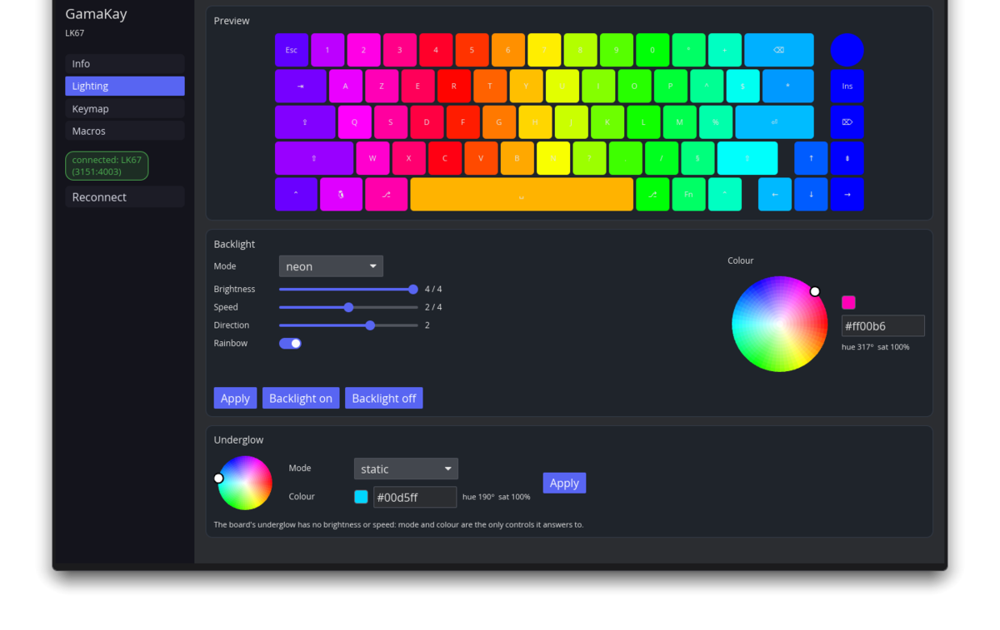

# lk67ctl

**Your GamaKay LK67, configured from Linux — natively, without the Windows app.**

[](https://github.com/AessemOps/lk67ctl/actions/workflows/ci.yml)
[](LICENSE)

GamaKay only ships a Windows Electron app for the LK67. This is a native Rust
replacement: lighting and the underglow, keymaps, macros and device info,
written straight to the keyboard's own memory over USB, with a GUI and a
scriptable CLI.

**Unofficial.** "GamaKay" and "LK67" identify the maker and model of the board
this tool configures; the project is not affiliated with, endorsed by or
supported by GamaKay. It speaks the board's own HID protocol for
interoperability and ships no vendor code or artwork.

- **Nothing stays resident.** Every command writes to onboard memory and exits —
  no tray daemon, no background service, no kernel module.
- **The keyboard keeps typing while you configure it.** It speaks the ROYUAN
  `yc500` protocol over Linux **hidraw**, so the kernel driver stays bound;
  no libusb, no device detaching.
- **No root, once the udev rule is installed.** The packages ship it.
- **Nothing that can brick the board.** A command allow-list plus a
  destructive/boot block-list sits in front of every write, and there is no
  firmware-flashing path at all.
- **Packaged for Arch, Debian/Ubuntu, Fedora/RHEL and as an AppImage.**

## Features

| | |
|---|---|
| **Lighting** | Onboard modes with brightness, speed and direction, rainbow, and a colour picker with a live preview of the board. |
| **Underglow** | The board's side and bottom-mesh LEDs — the ones GamaKay's own software leaves alone — with their own modes, a colour wheel and a rainbow toggle. |
| **Keymap** | Remap any key on the base **and Fn** layers, across the board's **8 profiles**. Remap by pressing a key on the keyboard, or pick one from a VIA-style list of ~115 keys — media, modifiers, macros, profiles. |
| **Macros** | 50 onboard slots with a **recorder**: press Record, type the macro, press Stop, save it to a slot. Delays are captured, so the take keeps your typing rhythm. A CLI step DSL covers scripted cases. |
| **Device info** | Firmware, active profile, the options the firmware exposes. |
| **GUI + CLI** | An iced app for interactive work; a `lk67ctl` command for scripts, profiles and CI. |



## Install

Grab the package for your distribution from the
[latest release](https://github.com/AessemOps/lk67ctl/releases), or build
them yourself (see [docs/packaging.md](docs/packaging.md)):

| Distribution | Package |
|---|---|
| Arch / CachyOS | `lk67ctl-<ver>-1-<arch>.pkg.tar.zst` |
| Debian / Ubuntu | `lk67ctl_<ver>_amd64.deb` |
| Fedora / RHEL | `lk67ctl-<ver>-1.x86_64.rpm` |
| Anything else | `lk67ctl-<ver>-x86_64.AppImage` |

```bash
sudo pacman -U lk67ctl-*.pkg.tar.zst
sudo apt install ./lk67ctl_*.deb
sudo dnf install ./lk67ctl-*.rpm
chmod +x lk67ctl-*.AppImage && ./lk67ctl-*.AppImage
```

The deb, rpm and Arch packages install a **udev rule** that lets you configure
the keyboard as your normal user, and reload udev for you. An AppImage cannot
touch `/etc`: install the rule it ships (`/usr/share/udev/70-lk67ctl.rules`
inside the archive), or run the tools as root.

## Quick start

```bash
lk67ctl list                     # every HID node, with the board marked
lk67ctl info                     # model, firmware, active profile
lk67ctl light set --color ff00aa --brightness 3 --mode wave
lk67ctl light edge set --mode breathing --color 00d5ff   # the underglow
lk67ctl keymap set --slot 9 --to Esc        # by slot
lk67ctl keymap get --fn                     # the Fn layer
lk67ctl keymap reset --yes                  # back to the board's defaults
lk67ctl macro set 3 --steps 'H+@20, i+@30, i-@40' --repeat 1
lk67ctl apply my-profile                    # a TOML profile of lighting + remaps
```

`lk67ctl --dry-run …` prints the exact packets a command would send and sends
no writes. `lk67ctl <command> --help` has the rest; `docs/protocol.md` documents
the wire protocol itself.

The GUI opens with `lk67-gui` (or `lk67-gui macros` to start on a tab).
It shares one worker thread with the device, so a slow board never freezes the
window, and it is a single window that does nothing when idle.

## How it works

The LK67 exposes a 64-byte HID **feature report** on its keyboard collection.
Every setting is a feature transfer with an opcode, a checksum, and — for the
keymap and macros — 56-byte pages it commits to flash.

Two things surprise people, and both are handled:

- **Writing is fire-and-forget.** A read inside the flash-commit window stalls
  the board's settings endpoint until it is re-enumerated, so the tool waits the
  commit out rather than polling. If a write is ever interrupted, unplug and
  replug the keyboard; typing is never affected.
- **The keymap is per profile.** Eight separate keymaps exist and the protocol
  only ever addresses the *active* one, so selecting a profile to edit is a real
  change to the board: the tool restores the profile you were on when it is
  done.

## Compatibility

| | |
|---|---|
| Keyboard | GamaKay LK67 (`yzw_lk67`, ROYUAN `yc500` family) |
| Firmware | `3151:4003` (2026-10 update, id 290) and `0461:4002` (id 149) |
| Transport | **USB cable only** |
| OS | Linux with `hidraw` (any distribution; packages above) |

**2.4 GHz and Bluetooth are out of scope.** They were investigated and dropped,
with the measurements kept in [docs/protocol.md](docs/protocol.md) → "Scope: USB
cable": the receiver declares no HID feature report, so this protocol cannot be
addressed over it at all. Mode switching and pairing are physical (the switch on
the keyboard), not configurable from software.

Other boards that share these USB ids are refused before anything is written —
the tool identifies the board with a handshake, not by VID/PID — and
`--force` overrides that when you know better.

**Want another board supported?** Run `scripts/dump-keyboard.sh` with it
plugged in and attach the directory it writes to an issue. It is read-only —
only GET requests are sent — and serial numbers are redacted. It records the
interface identity, the raw report descriptor, and the board's reply to every
documented app-mode GET opcode, which is what adding a board to
`docs/protocol.md` starts from.

## Safety

- Every write passes a guard holding a default-deny **allow-list** of the
  commands in `docs/protocol.md` and a **block-list** of destructive and
  bootloader opcodes. No firmware-flashing path exists in the code.
- Reads and writes are length- and checksum-checked; a short transfer from the
  board is an error, not zero-filled data.
- The board's firmware-owned Fn keys are painted red in the preview. The
  firmware ignores writes to those slots rather than the protocol refusing them,
  so remapping one has no effect.
- If a board stops answering, `lk67ctl keymap reset --yes` sends the factory
  reset (`0x02`); the LK67 also resets with `Fn`+`Esc` held for about three
  seconds.

## Development

```bash
make lint      # fmt --check, clippy -D warnings
make check     # the two above, then the test suite (it formats first)
make release   # LTO, stripped, panic=abort
make packages  # deb + rpm + AppImage into dist/
make package-arch
```

| Path | What it is |
|---|---|
| `crates/lk67-core/` | Protocol encode/decode, device table, safety guard, `Transport` trait |
| `crates/lk67-hidraw/` | The Linux hidraw layer: sysfs enumeration and the feature-report ioctls |
| `crates/lk67-cli/` · `crates/lk67-gui/` | The two front-ends |
| `docs/protocol.md` | The command reference, byte layouts and what is safe |
| `docs/packaging.md` · `docs/re-workflow.md` | How it is packaged; how the protocol was captured |
| `.kilo/plans/` | The implementation plans, for anyone picking this up |

## Changelog

What changed in each release, including the audit fixes that went into 0.1.0, is
in [CHANGELOG.md](CHANGELOG.md).

## License

GPL-3.0-or-later. Third-party attribution — including the bundled Noto Emoji
font and the parts ported from other projects — is in [CREDITS.md](CREDITS.md).
